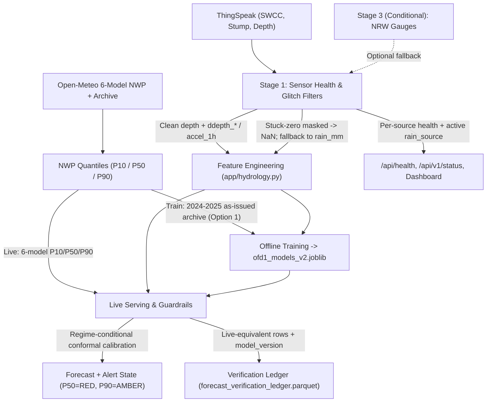

# Improving OFD1 +6h Flood Forecast Accuracy & Gauge Resilience

* **Author:** Jake Watson
* **Date:** 2026-11-14
* **Status:** Finalized Draft

---

## The Problem

Cavers heading underground into Ogof Ffynnon Ddu 1 (OFD1) rely on the +6h streamway depth forecast for same-day go/no-go decisions, where 700 mm is the red flood-alert threshold. Over 1–14 November 2026, the +6h forecast failed in two ways that undermine trust in the warning system:

1. **False red flood alarms on dry or light-rain days:** On 10–11 November, the +6h forecast peaked near 740 mm median (and ~1050 mm at P90), triggering nine false `>=700 mm` alarms in the 14-day window, while actual depth only rose from 575 mm to 615 mm and arrived roughly six hours later than predicted.
2. **Downward overshoots and multi-hour lag after sudden depth changes:** On 12–13 November, depth rose from 600 mm to 680 mm with zero rain recorded on any gauge or weather model, then dropped back to 584 mm within two hours. The +6h forecast lagged by about six hours and then extrapolated the sudden drop downward to ~500 mm (repeating a similar overshoot after a ~60 mm drop on 2 November).
3. **Over-confident uncertainty bands in quiet weather:** During both July 2026 and 1–14 November 2026, actual depths fell inside the P10–P90 band only 63–66% of the time (against an 80% target), because quiet-weather bands narrow to roughly 8 mm at +6h.

The SWCC valley rain gauge has been offline since 4 November 2026, and The Stump upland gauge reported `0.0` throughout 10–11 November even as the stream rose 40 mm. However, code and ledger inspection shows that simply adding backup rain gauges will not fix the false alarms or the overshoots. The failures come from four coupled issues inside the forecasting pipeline:

* The +6h models are trained on actual future rainfall (`rain_mm.shift(-h)`) but served uncertain Open-Meteo weather forecasts, and the hydrological guardrail lets forecast rain raise its own rise cap.
* A rain gauge stuck at `0.0` is treated as a valid zero rather than missing (`NaN`), which blocks the existing fallback to Open-Meteo `rain_mm`.
* Raw streamway depth has no step-drop glitch filter, so sudden drops are treated as sustained downward momentum.
* Evaluation in the verification ledger uses hindsight future rain and skips live ensemble combining, hiding what cavers actually experience on the dashboard.

## Overview

This design fixes the +6h forecast reliability problems in stages, starting inside the existing pipeline before taking on external API dependencies:

* **Stage 0 (Diagnosis & Physical Verification):** Replay the 2 Nov, 10–11 Nov, and 12–13 Nov events through the live prediction path using archived weather forecasts, and confirm on site whether the sudden 60–100 mm depth drops are sensor faults or real cave behaviour.
* **Stage 1 (Internal Pipeline & Observability Fixes):** Detect stuck-zero rain gauges so fallback activates, stop forecast rain from raising its own +1–6h red-alert cap, filter or damp non-physical depth step-drops, and show per-source gauge health on the dashboard.
* **Stage 2 (Model Alignment, Calibration & Honest Evaluation):** Align training and verification with archived weather forecasts rather than hindsight rain, recalibrate uncertainty bands for dry regimes so coverage reaches ~80%, and version model and ledger artifacts (`v2`) for safe rollback.
* **Stage 3 (Conditional External Backup):** Only if Stage 1–2 still miss rise timing during local gauge outages, add Natural Resources Wales (NRW) telemetered gauges as an optional, non-safety-critical input inside the observed-rain fallback chain.

## Goals

* **Eliminate false red alarms from unconfirmed forecast drizzle:** Zero false `>=700 mm` P50 alerts during dry/light-rain events like 10–11 Nov 2026, while preserving existing recall on actual `>=700 mm` flood events.
* **Make rain-gauge fallback work when a gauge flatlines:** Automatically quarantine stuck-zero rain gauges so the fallback chain activates and operators can see which rain source is active.
* **Stop downward overshoots after sudden depth drops:** Prevent sudden 60–100 mm drops from pushing +6h forecasts below actual baseflow, without masking genuine storm recessions.
* **Restore ~80% P10–P90 band coverage in dry weather:** Keep uncertainty bands calibrated across low, rising, and falling flow regimes.
* **Match evaluation to live serving:** Measure all changes against archived as-issued weather forecasts (`ofd1_nwp_archive.parquet`) using event-level false alarms, flood recall, and peak timing error in hours.

## Non-Goals

* **Ingesting rain radar (RainViewer or Met Office NIMROD):** RainViewer retains only ~2 hours of history (unusable for 2015–2025 training), and NIMROD requires heavy gridded processing while still under-measuring upland rain.
* **Running multi-year backfills or model retraining inside Kubernetes pod startup:** Startup must stay well within the 120-second probe budget and 1 GiB memory limit.
* **Treating NRW's un-SLA'd API as a sole safety-critical trigger:** Any external backup feed must degrade gracefully to local/model fallbacks if unavailable or unconfigured.

---

## Technical Plan

### Architecture & Data Flow

The pipeline separates **sensor health checks** and **observed-rain fallback** from **forecast-rain (NWP) features**, so a stuck gauge or uncertain weather forecast cannot silently corrupt `+1..+6h` predictions:

### Stage 0: Event Replay & Physical Verification

1. **Live-path replay script:** Replay 2 Nov, 10–11 Nov, and 12–13 Nov 2026 through the exact live serving path (`roll_future_features_for_horizon`, `combine_ensemble_quantile_deltas`, `apply_hydrological_guardrails`) using `data/ofd1_nwp_archive.parquet` (which covers `2024-01-01` through `2026-11-08` across all 6 models at `d0`/`d1`/`d2`, supplemented by saved live payloads for `2026-11-09`–`2026-11-14`). Measure the separate contribution of (a) stuck Stump `0.0` blocking `rain_mm` fallback, (b) `fut_*` hindsight skew, (c) `apply_hydrological_guardrails` using `fut_rain_sum_6h_at_target`, and (d) `ddepth_*` / `accel_1h` extrapolation of sudden drops.
2. **Site check:** Confirm whether the ~60 mm drop on 2 Nov and the ~96 mm drop on 13 Nov (05:00–07:00 UTC) are sensor artifacts or physical karst events (sump/debris release), and inspect The Stump rain gauge for funnel blockage.

### Stage 1: Internal Pipeline & Observability Fixes

1. **Stuck-zero rain-gauge quarantine (`app/hydrology.py: engineer_features`):**
   * Today `club_rain_mean = df[["stump_rain_clean", "swcc_rain_mm"]].mean(axis=1)` treats a stuck `0.0` on Stump as valid, preventing `.fillna(df["rain_mm"])` from firing.
   * Add a stuck-zero detector before `club_rain_mean`: mask a gauge to `NaN` when it reads `0.0` continuously for a sustained window while either (a) a peer observed gauge is non-zero, (b) `rain_mm` exceeds a convective threshold, or (c) `depth_mm` rises above noise (`ddepth_3h > threshold`). Emit `stump_status`, `swcc_status` (`ok | offline | stuck_zero | glitch`), and `rain_source` (`club | swcc | stump | nrw | open_meteo`).
2. **Depth step-drop glitch filter (`app/hydrology.py: engineer_features`):**
   * Before computing `ddepth_*` and `accel_1h`, detect single-step or 2-hour drops exceeding physical karst recession rates when not preceded by a flood peak (thresholds calibrated against 2015–2025 recessions and Stage 0 findings). Mask or freeze momentum derivatives across the step so the model does not project a sensor drop downward to ~500 mm.
3. **Decouple P50 and P90 guardrails (`app/hydrology.py: apply_hydrological_guardrails`):**
   * Currently `rain_avail = r3h + rfut` allows `fut_rain_sum_6h_at_target` (NWP) to raise `allowed_rise` for P50.
   * Restrict the `+1..+6h` P50 `allowed_rise` cap to confirmed observed rain (`r3h`) plus active stream rise, while keeping `r3h + rfut` on P90. Unconfirmed NWP rain can raise an **AMBER** watch (P90) but cannot push P50 into a **RED** (`>=700 mm`) alarm without observed rain or stream rise.
   * Return guardrail clamp telemetry (`guardrail_clamped`, `p50_clamp_shift_mm`, `p90_clamp_shift_mm`) for logging and diagnostics.
4. **Per-source health & degraded-mode UI (`app/engine.py`, `app/main.py`, `app/static/`):**
   * Track per-source sync status (`status`, `last_success_utc`, `http_status`, `latency_ms`, `consecutive_failures`) for ThingSpeak, Open-Meteo deterministic, and Open-Meteo 6-model ensemble inside `OFD1ForecastEngine` without wrapping all sources in one coarse `try/except`.
   * Expose `rain_source_active` and per-gauge health in `/api/v1/status` and `/api/health` (additive fields only). Display a clear degraded-mode banner on the dashboard when no observed rain gauge is healthy (`"OBSERVED RAIN UNAVAILABLE — Forecast driven by weather models only"`).

### Stage 2: Archived NWP Training, Calibration & Artifact Versioning

1. **Train on archived as-issued NWP (`app/engine.py`, `app/hydrology.py`, offline training script):**
   * `data/ofd1_nwp_archive.parquet` provides 2024–2025 as-issued forecasts (`d0`/`d1`/`d2` across all 6 models) inside the `< 2026-01-01` training split, and 2026 forecasts in the out-of-sample test split.
   * For `2024-01-01` onward, build `fut_*` training features from the archived 6-model NWP median (`d0`/`d1`/`d2` matched by lead hour) instead of hindsight `rain_mm.shift(-h)`. For pre-2024 rows (`2015–2023`, where no NWP archive exists), keep `rain_mm.shift(-h)` with lower sample weight (or down-weight pre-archive rows further relative to the existing `2.5x` modern-era weight) so `+1..+6h` models learn real NWP error characteristics without discarding 2015–2023 flood peaks.
2. **Regime-conditional conformal band recalibration:**
   * Calibrate additive P10/P90 conformal offsets on 2024–2025 out-of-fold residuals stratified by flow regime (`low/dry`, `rising`, `falling`) so quiet-period P10–P90 coverage reaches ~80% instead of 63–66%.
3. **Honest verification ledger & evaluation (`app/engine.py`, `app/static/app.js`):**
   * Re-generate 2026 out-of-sample verification rows using archived as-issued NWP + `combine_ensemble_quantile_deltas` + guardrails so the ledger reflects what cavers actually see.
   * Distinguish `"live_forecast"` from `"catchup_hindsight"` and record `model_version` in `forecast_verification_ledger.parquet`.
   * Contextualize dry-period persistence skill in the verification UI (show a low-variance note when depth std < threshold) and track event-level metrics: false `>=700 mm` P50 alarms, `>=700 mm` flood recall, peak timing error (hours), and per-regime P10–P90 coverage.
4. **Artifact & PVC versioning (`app/engine.py`, `Dockerfile`, `k8s/deployment.yaml`):**
   * Save retrained models as `ofd1_models_v2.joblib` with embedded `feature_cols` and `schema_version` metadata.
   * Keep `ofd1_aligned_hourly.parquet` schema strictly additive and perform training strictly offline/in CI (baked into `seed_data`), never inside container `initialize()`, respecting the `1Gi` memory limit and 120s `startupProbe` budget. Rollback to `v1` remains a config/image revert.

### Stage 3: Conditional NRW Fallback Integration

* **Gate condition:** Proceed to Stage 3 only if Stage 2 evaluation on 2026 data still shows missed or late `+6h` rise timing during ThingSpeak gauge outages.
* **Integration shape (if triggered):**
  * Audit candidate upper Tawe/Usk NRW rain and river-level stations for 2015–2026 completeness, latency, and raw-vs-QC'd revision behaviour.
  * Inject `NRW_API_KEY` as an optional Kubernetes `Secret` (`optional: true` in `k8s/deployment.yaml` / `k8s/flux-cd/ofd1-forecast.yaml`), isolated in its own non-blocking `try/except` with short timeout and 15-min completeness tracking (`samples_per_hour`).
  * Fold NRW into the `fused_rain_mm` fallback chain (`club -> nrw -> open_meteo`) rather than adding NRW-specific columns to `CAUSAL_COLS`, avoiding brittle schema coupling if NRW is unavailable.

---

## Alternatives Considered

* **Add NRW telemetered rain gauges immediately with a 2015–2026 backfill and model retrain:** Deferred to Stage 3 by author. Adding NRW gauges does not fix the NWP hindsight/guardrail skew behind the 10–11 Nov false alarms, does not fix the stuck-zero bug that blocks fallback, and does not fix depth step-drop overshoots (12–13 Nov). It also requires API-key secret management, 15-minute completeness handling, auditing 11 years of station gaps/revisions, and orographic bias checks for an API that carries no SLA.
* **Ingest UK rain radar (RainViewer or Met Office NIMROD):** Rejected by author. RainViewer retains only ~2 hours of history, so it cannot be used to train 2015–2025 models without collecting data for a year or more first. Met Office 1 km NIMROD archives on CEDA require registration and heavy gridded spatial processing, and radar still under-measures rain on high ground like the Black Mountain plateau unless calibrated against working gauges.
* **Cap Open-Meteo precipitation probability (`precip_prob_pct`) in the model:** Rejected by author. Code inspection showed `precip_prob_pct` is display-only and is not included in `nwp_cols_for_horizon(h)`, so capping or discounting PoP inside the model would have no effect.
* **Train with synthetic NWP-error perturbation instead of archived NWP:** Rejected by author in favour of training directly on `data/ofd1_nwp_archive.parquet` (2024–2025), because real Open-Meteo errors have multi-hour persistence (such as 12-hour drizzle bands) that synthetic per-hour noise would approximate poorly.
* **Remove `fut_*` NWP features from `+1..+6h` P50 models:** Rejected by author in favour of training P50 on archived as-issued NWP and decoupling the P50/P90 guardrails, so `+4..+6h` P50 retains genuine early-warning capability for well-forecast frontal storms.
* **Drop monotonic constraints (`monotonic_cst=+1`) on NWP features:** Rejected by author. Positive monotonicity (more forecast rain cannot lower predicted depth) is physically sound; the failure came from training on hindsight rain and letting NWP rain raise its own guardrail cap.
* **Use NRW river-level gauges on the upper Tawe/Usk instead of rain gauges:** Kept open as an alternative for Stage 3. If Stage 1–2 evaluation still shows missed rise timing during local gauge outages, nearby river-level hydrographs may provide stronger confirmation than valley rain gauges.

---

## Detailed Implementation

All changes below are grouped into one sequential delivery list across Stages 0, 1, and 2 (with Stage 3 gated on Stage 2 evaluation results). No implementation code is included; schema and API contracts are noted where interfaces change.

1. **Stage 0 — Diagnostic Replay & Physical Verification**
   * **Create `scripts/replay_nov_events.py` (or temporary diagnostic script) and update `scripts/README.md`:**
     * *What:* Replay `2026-11-01` through `2026-11-14` (and `2026-07-01` through `2026-08-10`) through `roll_future_features_for_horizon`, `combine_ensemble_quantile_deltas`, and `apply_hydrological_guardrails` using `data/ofd1_nwp_archive.parquet` (up to `2026-11-08`) and saved/reconstructed live NWP inputs (`2026-11-09`–`14`), logging pre-guardrail vs. post-guardrail P50/P90 deltas.
     * *Why:* Quantifies the exact share of the 10–11 Nov false flood and 2 Nov / 13 Nov overshoots caused by hindsight `fut_*` skew, guardrail `rain_avail`, stuck-zero Stump readings, and unfiltered depth step-drops before changing production code.
   * **Physical check (operator action, no code):** Confirm whether the ~60 mm drop on 2 Nov and ~96 mm drop on 13 Nov (05:00–07:00 UTC) are sensor faults or karst sump releases, and inspect The Stump rain gauge for funnel blockage.

2. **Stage 1 — Sensor Health, Depth Step-Drop Filter, Guardrail Split & UI Provenance**
   * **Modify `app/hydrology.py`:**
     * *What:*
       1. Add stuck-zero rain-gauge masking before `club_rain_mean` in `engineer_features`: flag a gauge as `stuck_zero` and mask its readings to `NaN` when it reports `0.0` continuously for `N` hours (e.g., 6 hours) while a peer gauge, `rain_mm`, or streamway rise (`ddepth_3h`) indicates active rainfall, allowing `.fillna(df["rain_mm"])` to fire. Emit `stump_status`, `swcc_status`, and `rain_source` provenance columns.
       2. Add a depth step-drop glitch filter before computing `ddepth_*` and `accel_1h` in `engineer_features`: detect non-physical drops exceeding calibrated karst recession bounds (unless Stage 0 confirms they are real sump releases, in which case damp momentum extrapolation rather than masking raw depth) and emit `depth_glitch_flag`.
       3. Update `apply_hydrological_guardrails` to separate P50 and P90 `rain_avail`: compute `+1..+6h` P50 `allowed_rise` from `r3h` (observed rain) + active stream rise (`ddepth_1h`), while keeping `r3h + rfut` for P90, and return clamp telemetry (`p50_clamp_shift_mm`, `p90_clamp_shift_mm`).
     * *Why:* Fixes the silent stuck-zero block, stops sensor step-drops from driving downward overshoots, and prevents unconfirmed NWP drizzle from triggering RED (`>=700 mm`) P50 alarms.
   * **Modify `app/engine.py`:**
     * *What:* Isolate ThingSpeak, Open-Meteo deterministic, and Open-Meteo 6-model ensemble fetches inside `refresh_live_telemetry` into per-source `try/except` blocks tracking `status`, `last_success_utc`, `http_status`, `latency_ms`, and `consecutive_failures`. Expose `source_health` and `rain_source_active` in `latest_payload["gauges"]` and guardrail clamp metadata in forecast diagnostics.
     * *Why:* Replaces the single coarse `sync_status` string so 3 AM triage can distinguish ThingSpeak vs. Open-Meteo failures and operators know when the system is running without observed rain.
   * **Modify `app/main.py`:**
     * *What:* Add `source_health` and `rain_source_active` fields (additive, backward-compatible) to `/api/health` and `/api/v1/status`.
     * *Why:* Surfaces degraded-mode and gauge provenance over the API without breaking existing health checks.
   * **Modify `app/static/index.html`, `app/static/app.js`, and `app/static/styles.css`:**
     * *What:* Render per-gauge health badges (`ok` / `offline` / `stuck_zero`) and a degraded-mode banner when `rain_source_active == "open_meteo"` (`"OBSERVED RAIN UNAVAILABLE — Forecast driven by weather models only"`). In the verification panel, add a low-variance note on persistence skill when window depth standard deviation is small.
     * *Why:* Prevents cavers from treating NWP-only forecasts as gauge-confirmed and explains why dry-period persistence skill looks negative despite low MAE.

3. **Stage 2 — Archived NWP Training, Calibration & `v2` Artifact Versioning**
   * **Modify `app/hydrology.py`:**
     * *What:* Add a helper to construct `fut_*` training columns from `data/ofd1_nwp_archive.parquet` (matching lead hours across `d0`/`d1`/`d2` 6-model median) for `2024-01-01` onward, and add regime-conditional conformal offset helpers (`low`, `rising`, `falling`) for P10/P90 calibration.
     * *Why:* Aligns `+1..+6h` training features with what live serving actually receives and restores ~80% P10–P90 coverage in dry weather.
   * **Modify `app/engine.py`:**
     * *What:*
       1. Update `_train_and_save_models` to use archived as-issued NWP for `2024–2025` training rows, fit regime-conditional conformal offsets on 2024–2025 out-of-fold residuals, and save `ofd1_models_v2.joblib` containing `models`, `conformal_offsets`, `feature_cols`, and `schema_version`.
       2. Update `initialize()` to load `ofd1_models_v2.joblib` (with additive PVC parquet checks and no in-pod retraining fallback that could breach the 120s `startupProbe` or `1Gi` memory limit).
       3. Update `_ensure_and_update_verification_ledger` to tag `"live_forecast"` separately from `"catchup_hindsight"` and `"backtest_2026_nwp"`, record `model_version`, and evaluate 2026 out-of-sample rows using archived as-issued NWP + `combine_ensemble_quantile_deltas` + guardrails.
     * *Why:* Eliminates train/serve skew, makes the verification ledger honest, and preserves clean rollback to `ofd1_models_v1.joblib`.
   * **Create/Update `scripts/retrain_v2.py` and `scripts/backtest_nwp_ensemble.py`:**
     * *What:* Offline script to run Stage 2 training, compute event-level 2026 evaluation metrics (false `>=700 mm` P50 alarm count, `>=700 mm` flood recall, peak timing error in hours, and per-regime P10–P90 coverage), and write `data/ofd1_models_v2.joblib` for `seed_data`.
     * *Why:* Keeps heavy training and 2026 backtesting strictly offline/in CI, outside Kubernetes pod startup.
   * **Modify `Dockerfile` and `k8s/deployment.yaml` (if needed for `v2` env/config):**
     * *What:* Ensure `seed_data/` packages `ofd1_models_v2.joblib` (while keeping `ofd1_models_v1.joblib` / additive parquet compatibility for rollback) and add a `MODEL_VERSION` env var (`v2`, revertible to `v1`).
     * *Why:* Enables zero-PVC-wipe rollback between `v2` and `v1`.
   * **Modify `tests/test_hydrology.py`, `tests/test_skill_regression.py`, and `tests/test_api.py`:**
     * *What:* Add unit and regression tests for stuck-zero masking + `rain_mm` fallback, depth step-drop filtering, P50 vs. P90 guardrail separation, archived-NWP feature alignment, conformal coverage in dry windows, `v2` artifact loading, and `/api/health` / `/api/v1/status` `source_health` schema.
     * *Why:* Verifies every Stage 1–2 invariant automatically in CI.
   * **Update `README.md`, `app/README.md`, `app/static/README.md`, and `scripts/README.md`:**
     * *What:* Document the `v2` model artifact, stuck-zero/step-drop filters, per-source health fields, and offline retraining script.
     * *Why:* Keeps repository documentation aligned with the updated pipeline.

4. **Stage 3 — Conditional NRW Fallback (Only if Stage 2 Evaluation Still Misses Timing)**
   * *Files touched if triggered:* New `scripts/backfill_nrw_gauges.py` (offline station audit + backfill), `app/engine.py` (optional non-blocking NRW fetch into `nrw_rain_mm`), `app/hydrology.py` (insert `nrw_rain_mm` into `fused_rain_mm` fallback chain `club -> nrw -> open_meteo` without altering `CAUSAL_COLS`), `k8s/deployment.yaml` and `k8s/flux-cd/ofd1-forecast.yaml` (optional `NRW_API_KEY` `secretKeyRef`).
