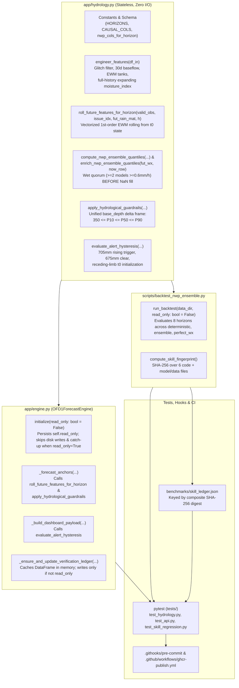

# Hydrological Core Extraction and Forecast Skill Regression Gates

*   **Author:** Jake Watson
*   **Status:** Approved
*   **Date:** 2026-11-14

--------------------------------------------------------------------------------

## Overview

The OFD1 Streamway flood forecasting system predicts underground water depth (in millimeters) across a 48-hour horizon (+1h to +48h) using upstream rainfall gauges, soil moisture telemetry, a 6-model numerical weather prediction (NWP) super-ensemble (aggregating 149 upstream ensemble members across UKMO, ECMWF, ICON, AROME, GFS, and Open-Meteo `best_match`), and gradient-boosted quantile models (P10, P50, P90).

Currently, the core hydrological math—sensor glitch filtering, causal rainfall and peat-tank exponential decay features, NWP ensemble quantile aggregation, physical recession guardrails, and caver safety alert hysteresis—is trapped inside `OFD1ForecastEngine` in `app/engine.py` (2,385 lines) alongside external HTTP requests, disk persistence, and background sync loops. A second copy of the NWP quantile math, future rainfall rolling, and multi-horizon spread aggregation exists in `scripts/backtest_nwp_ensemble.py`.

This design extracts all pure hydrological transformations into a single stateless module (`app/hydrology.py`), fixes mathematical divergences between live inference and offline backtesting (including a reference-frame bug in the `p10` lower bound clamping), adds an offline `pytest` suite with read-only test seams, and enforces out-of-sample 2026 forecast skill regression gates keyed by standalone file content SHA-256 digests in both a local git hook and GitHub Actions CI.

## The Problem

1.  **Duplicated Hydrological Logic and Live-vs-Backtest Drift**:
    *   `app/engine.py` and `scripts/backtest_nwp_ensemble.py` maintain separate implementations of NWP ensemble quantile computation, future rainfall rolling, and physical guardrail clamping.
    *   **`d_p10` Reference-Frame Bug**: `OFD1ForecastEngine._apply_hydrological_guardrails` (`app/engine.py:298-350`) clamps `d_p10` against `clamped_p50` (`np.minimum(dp10, clamped_p50)`), assuming `d_p10`, `d_p50`, and `d_p90` are all depth deltas relative to `base_depth`. However, both `app/engine.py:_forecast_anchors` (lines 923–929) and `scripts/backtest_nwp_ensemble.py` (lines 318–324) pass `d_p10 = -total_low_spread` (an offset relative to `p50`, not `base_depth`). When reconstructing absolute depth, `app/engine.py` adds the clamped value to `p50` (double-subtracting `d_p50_c` on receding hours), while `scripts/backtest_nwp_ensemble.py` adds `np.minimum(d10_c, d50_c)` to `base_d`. In the backtest, every receding hour where `d50_c < -total_low` collapses `p10_ens` onto `p50_ens` (0 mm lower band width), and rising limbs anchor `p10_ens` to `base_d - total_low` instead of `p50_ens - total_low`. This depresses 2026 `ensemble` P10–P90 coverage in `data/nwp_ensemble_backtest_summary.csv` to `50.17%–57.51%` (compared to `67.22%–72.33%` for `deterministic`).
    *   **Inconsistent Guardrail Application**: `scripts/backtest_nwp_ensemble.py` applies `_apply_hydrological_guardrails` only to the `ensemble` mode and skips it for `deterministic` and `perfect_wx` modes.
    *   **Expanding-Window Slice Drift**: `OFD1ForecastEngine._engineer_features` (`app/engine.py:254-260`) computes `soil_min`, `soil_max`, and the 95th percentile of `tank_168h` using `.expanding(min_periods=48)`. During live anchor inference, `_forecast_anchors` (`app/engine.py:836-855`) re-runs `_engineer_features` three times on an 800-row tail (`valid_obs.loc[:now_ts].tail(800)`), normalizing `moisture_index` against a 33-day local window instead of the multi-year expanding window used during training and backtesting.
    *   **NWP Missing-Member Fill Before Quorum Check**: Both `app/engine.py:694-709` (`_enrich_nwp_ensemble_quantiles`) and `scripts/backtest_nwp_ensemble.py:90` fill missing NWP member columns (`M = 6` models) with `det_rain` before checking `wet_members_count = np.sum(mat >= 0.6, axis=0)`, inflating the 2-model wet quorum whenever a model column is `NaN` and `det_rain >= 0.6`.
    *   **Alert Hysteresis Initialization at `h_step = 1`**: `app/engine.py:1056-1060` initializes `prev_status` using only `base_depth >= RED_DEPTH_MM` (`700.0 mm`), ignoring whether `t0` is already on a receding limb between `RED_CLEAR_DEPTH_MM` (`675.0 mm`) and `700.0 mm`.
2.  **Tightly Coupled Side Effects Prevent Offline Testing**:
    *   `app/main.py` instantiates `OFD1ForecastEngine` at import time, and its FastAPI `lifespan()` context manager runs `engine.initialize()` (writing `data/forecast_verification_ledger.parquet`) and spawns `_periodic_sync_loop()` (making live HTTP calls and overwriting `data/ofd1_aligned_hourly.parquet` and `data/ofd1_future_nwp_ensemble.parquet`).
    *   `scripts/backtest_nwp_ensemble.py:main()` unconditionally overwrites git-tracked `data/nwp_ensemble_backtest.parquet` and `data/nwp_ensemble_backtest_summary.csv`.
3.  **Zero Automated Tests or Forecast Skill Regression Gates**:
    *   The repository has no `pytest` suite, no local git hooks, and a GitHub Actions workflow (`.github/workflows/ghcr-publish.yml`) that builds and publishes the container image without verifying unit tests or out-of-sample forecast skill metrics.

## Goals

*   Extract all pure hydrological transformations—constants, sensor glitch filtering, causal rainfall and peat-tank feature engineering, horizon future-column attachment, 6-model NWP super-ensemble (149 upstream members) quantile and wet-quorum aggregation, physical recession and dry-clamp guardrails, and alert hysteresis—into a single flat, stateless module (`app/hydrology.py`) with zero file I/O or network dependencies, while retaining thin delegating methods on `OFD1ForecastEngine` for backward compatibility.
*   Fix the `d_p10` reference-frame bug so `d_p10`, `d_p50`, and `d_p90` all represent depth deltas relative to `base_depth` (`d_p10 = d_p50 - total_low_spread`), apply physical guardrails across all backtest modes (`deterministic`, `ensemble`, `perfect_wx`), unify future feature rolling via vectorized 1st-order EWM recurrence using full-history expanding bounds (`soil_min`, `soil_max`, `tank_168h_p95`), evaluate the NWP wet quorum prior to `NaN` fallback filling, and regenerate the 2026 baseline artifacts (`data/nwp_ensemble_backtest.parquet` and `data/nwp_ensemble_backtest_summary.csv`).
*   Add `read_only: bool = False` execution seams to `OFD1ForecastEngine` and `scripts/backtest_nwp_ensemble.py` so tests and FastAPI `TestClient` can run entirely offline in memory without mutating git-tracked files in `data/`.
*   Create an offline `pytest` test suite (`tests/`) covering:
    *   Feature causality (perturbing inputs at `t > t0` never alters engineered features at `t <= t0`), sensor glitch filter bounds, physical guardrail invariants (`350.0 <= P10 <= P50 <= P90`, recession envelope floor, dry/receding clamps), and alert hysteresis transitions (`675.0 mm` clear vs. `700.0 mm` / `705.0 mm` trigger, including receding-limb initialization at `t0`).
    *   FastAPI endpoint contracts (`/api/v1/status`, `/api/v1/forecast`, `/api/v1/history`, `/api/v1/simulate`, `/api/v1/verification`, `/api/v1/nwp-backtest`, `/health`, alongside existing `/api/*` dashboard routes) running in `read_only=True` mode.
    *   Out-of-sample 2026 forecast skill regression gates across horizons `+1h`, `+3h`, `+6h`, `+12h`, `+18h`, `+24h`, `+36h`, and `+48h` (verifying `mae_p50_mm`, `rmse_p50_mm`, `coverage_pct`, and flood F1 scores `f1_600_p50`, `f1_600_p90`, `f1_700_p50`, `f1_700_p90`).
*   Track 2026 forecast skill baselines in `benchmarks/skill_ledger.json` keyed by a standalone composite SHA-256 digest of the 6 forecasting source and model/data files (`app/hydrology.py`, `app/engine.py`, `scripts/backtest_nwp_ensemble.py`, `data/ofd1_models_v1.joblib`, `data/ofd1_aligned_hourly.parquet`, and `data/ofd1_nwp_archive.parquet`), enforced via a versioned local git hook and in `.github/workflows/ghcr-publish.yml` prior to building and pushing container images.

## Non-Goals

*   Refactoring the frontend (`app/static/app.js`, `app/static/index.html`, `app/static/styles.css`) or the Marimo research notebooks (`phase1_feasibility.py`, `phase2_forecasting_trials.py`).
*   Changing any existing FastAPI route URLs, query parameter names, or JSON response keys consumed by the dashboard.
*   Retraining `data/ofd1_models_v1.joblib`, altering model hyperparameters, or changing the trained `fut_ref_tank_24h` feature definition (`tank_24h.shift(-h)`) during this extraction.

## Open Questions

*   None. All architectural questions were resolved during the predecessor design brief and review stages.

## Critical User Journeys (CUJs)

### CUJ 1: Developer Modifies Hydrological Logic and Runs Local Verification

*   **Given**: A developer modifies feature engineering, NWP quantile weighting, or guardrail logic in `app/hydrology.py` or `app/engine.py`.
*   **When**: The developer runs `pytest` or triggers `.githooks/pre-commit` before committing.
*   **Then**:
    1.  Unit and API contract tests verify physical invariants (`350.0 <= P10 <= P50 <= P90`), causality, alert hysteresis, and FastAPI responses in `read_only=True` mode without modifying `data/`.
    2.  The pre-commit gate runs in read-only verification mode (`uv run python scripts/backtest_nwp_ensemble.py --verify-ledger --read-only` and `OFD1_READ_ONLY=1 uv run pytest -q`). If any of the 6 fingerprinted forecasting files changed without an updated ledger entry, the hook fails fast and instructs the developer to run `uv run python scripts/backtest_nwp_ensemble.py --update-ledger`, which evaluates all 8 horizons (`+1h` to `+48h`), verifies non-regression against `baseline_metrics` in `benchmarks/skill_ledger.json`, and updates `data/nwp_ensemble_backtest.parquet`, `data/nwp_ensemble_backtest_summary.csv`, and `benchmarks/skill_ledger.json`.

### CUJ 2: CI/CD Pipeline Gates Container Image Publishing on Tests and Skill Ledger

*   **Given**: A pull request or push to `main` triggers `.github/workflows/ghcr-publish.yml` in GitHub Actions.
*   **When**: The workflow runs prior to the Docker build and GHCR push job.
*   **Then**:
    1.  The `test-and-skill-gate` job runs `pytest` completely offline against the committed Parquet and joblib artifacts.
    2.  `tests/test_skill_regression.py` computes the composite SHA-256 digest of the 6 forecasting code and model/data files, verifies that a matching entry exists in `benchmarks/skill_ledger.json`, and asserts that all recorded and live skill metrics satisfy the non-regression thresholds.
    3.  If any unit test, API contract test, or skill gate fails, the workflow terminates and prevents publishing a broken container image to GHCR.

### CUJ 3: Live Anchor Forecast and Offline Backtest Produce Consistent Quantiles

*   **Given**: Historical observations in `data/ofd1_aligned_hourly.parquet`, live NWP ensemble forecasts in `data/ofd1_future_nwp_ensemble.parquet`, historical NWP ensemble forecasts in `data/ofd1_nwp_archive.parquet`, and trained models in `data/ofd1_models_v1.joblib`.
*   **When**: `OFD1ForecastEngine` generates a 48-hour forecast for a reference timestamp `t0` and `scripts/backtest_nwp_ensemble.py` evaluates the same timestamp `t0` given the same 48-hour NWP member trajectory.
*   **Then**: Both paths invoke the same functions in `app/hydrology.py` for expanding-window feature normalization, vectorized 1st-order EWM future rainfall rolling, 6-model NWP super-ensemble quantile aggregation, and `base_depth`-referenced guardrail clamping (`d_p10 = d_p50 - total_low_spread`), yielding identical P10, P50, and P90 depth trajectories.

## Technical Plan (Architecture)

### 1. System Architecture and Data Flow

The extraction separates pure, deterministic hydrological calculations from stateful I/O and web serving:



### 2. Stateless Hydrological Core (`app/hydrology.py`)

`app/hydrology.py` contains all constants, feature definitions, ensemble aggregation functions, physical guardrails, and alert state machines. It imports only standard library modules, `numpy`, and `pandas`, with zero file system or network access.

1.  **Constants, Domain Definitions & Feature Schema**:
    *   Exports `HORIZONS = [1, 2, 3, 6, 12, 18, 24, 36, 48]`, `EVAL_SKILL_HORIZONS = [1, 3, 6, 12, 18, 24, 36, 48]`, `STEP_DATUM_MM = 550.0` (physical height of the cave rock step datum in mm), `ELEVATED_DEPTH_MM = 600.0`, `AMBER_DEPTH_MM = 620.0`, `RED_DEPTH_MM = 700.0` (~6 inches over The Step), `RED_TRIGGER_DEPTH_MM = 705.0`, `RED_CLEAR_DEPTH_MM = 675.0`, `MIN_PHYSICAL_DEPTH_MM = 350.0`, `TRAIN_SPLIT_UTC`, `NWP_MODELS`, `NWP_MEMBER_MAP`, `CAUSAL_COLS`, and `nwp_cols_for_horizon(h: int) -> list[str]`.
    *   Domain rainfall series: `stump_rain_mm` (The Stump upland swallet gauge), `swcc_rain_mm` (SWCC HQ valley gauge), `club_rain_mean` (mean of cleaned Stump and SWCC gauges), `rain_mm` (Open-Meteo catchment reanalysis/NWP reference rain driving `ref_tank_*`), `fused_rain_mm` (`club_rain_mean` with fallback to `rain_mm`), and `net_rain` (evapotranspiration-adjusted `fused_rain_mm` driving `tank_*`).
    *   `app/engine.py` re-exports these symbols and keeps thin delegating methods (`_engineer_features`, `_attach_horizon_future_cols`, `_apply_hydrological_guardrails`, `_enrich_nwp_ensemble_quantiles`) so existing callers and notebooks remain compatible.
2.  **Causal Feature Engineering (`engineer_features` & `attach_horizon_future_cols`)**:
    *   `engineer_features(df_in: pd.DataFrame) -> pd.DataFrame`: Applies the Stump rain glitch mask, wind under-catch adjustment, 720-hour rolling 5th-percentile `baseflow_30d`, exponential moving average tanks (`tank_3h`..`tank_168h` on `net_rain`, `ref_tank_3h`..`ref_tank_168h` on `rain_ref`), expanding-window `soil_min`, `soil_max`, and `tank_168h_p95` columns for `moisture_index`, depth velocity/acceleration lags, rainfall lags/sums, and barometric pressure diffs.
    *   `attach_horizon_future_cols(df: pd.DataFrame, h: int) -> pd.DataFrame`: Preserves the exact column definitions expected by `data/ofd1_models_v1.joblib`, including the asymmetric `fut_ref_tank_24h` (`tank_24h` shifted by `-h`) alongside `fut_ref_tank_6h` and `fut_ref_tank_96h` (`ref_tank_6h` and `ref_tank_96h` shifted by `-h`).
3.  **Unified Future Feature Rolling (`roll_future_features_for_horizon` & `roll_future_moisture_series`)**:
    *   Eliminates the `.tail(800)` expanding-window slice drift and 3x redundant `_engineer_features` calls in `OFD1ForecastEngine._forecast_anchors`.
    *   Both `OFD1ForecastEngine._forecast_anchors` (where `len(issue_idx) == 1`) and `scripts/backtest_nwp_ensemble.py` (where `len(issue_idx) == N`) call `roll_future_features_for_horizon(valid_obs, issue_idx, fut_rain_mat, h)` using the vectorized 1st-order EWM recurrence along the lead-hour axis starting from the exact `t0` tank states (`ref_tank_6h`, `tank_24h`, `ref_tank_96h`) and full-history `moisture_index` already computed on `valid_obs`.
    *   For the dashboard's 48-hour `moisture_index` display series (`ext_feat["moisture_index"]`), `roll_future_moisture_series(now_row, fut_wx)` rolls `tank_168h` forward over the 48 future hours using the same 1st-order EWM recurrence and normalizes `era5_soil_moisture` and `tank_168h` against the full-history expanding bounds (`soil_min`, `soil_max`, and `tank_168h_p95`) stored on `now_row`.
4.  **NWP Super-Ensemble Quantile & Wet-Quorum Aggregation (`compute_nwp_ensemble_quantiles` & `enrich_nwp_ensemble_quantiles`)**:
    *   Operates across the `M = 6` NWP model series (`NWP_MODELS`, representing the 6-model super-ensemble that aggregates 149 upstream NWP members) for both 2D `(M, T)` single-anchor matrices and 3D `(M, N, T)` vectorized backtest arrays.
    *   Fixes the missing-member `NaN` fill ordering bug in both `app/engine.py` and `scripts/backtest_nwp_ensemble.py`: evaluates the 2-model wet quorum (`>= 0.6 mm/h`) on the raw un-imputed member matrix **before** filling `NaN` entries with `det_rain`, so a missing model column never counts as a second independent model voting for rain.
    *   Applies 48-hour storm volume conservation scaling (`[0.55, 1.15]` against the 48-hour member total P90 when >= 2 models predict >= 10.0 mm/48h, or P75 otherwise) along the trailing time axis (`axis=-1`).
5.  **Unified Reference-Frame Guardrails (`apply_hydrological_guardrails` & `reconstruct_depth_quantiles`)**:
    *   Standardizes the reference frame of `apply_hydrological_guardrails`: `d_p10`, `d_p50`, and `d_p90` are all depth deltas (in mm) relative to `base_depth`.
    *   Callers pass `d_p10 = d_p50 - total_low_spread`, `d_p50 = d_p50`, and `d_p90 = d_p50 + total_high_spread` (or raw model predictions `d10, d50, d90` for single-trajectory deterministic/perfect-wx runs).
    *   When the quiescent below-Amber clamp mask is active, `d_p50` and `d_p90` are capped by the physical karst rate-of-rise and peat-sponge infiltration ceiling, and `d_p10` is shifted by any downward clamp applied to `d_p50` so the lower spread `(d_p50 - d_p10)` is preserved without collapsing `p10` onto `p50`.
    *   `reconstruct_depth_quantiles` converts the clamped `base_depth`-relative deltas into absolute depths `(p10, p50, p90)` (and optional `p90_hydro_only`), guaranteeing `350.0 <= p10 <= p50 <= p90_hydro_only <= p90` across all live and backtest scenarios (`deterministic`, `ensemble`, and `perfect_wx`).
6.  **Alert Hysteresis State Machine (`compute_initial_alert_status` & `evaluate_alert_hysteresis`)**:
    *   Fixes the receding-limb initialization bug at `h_step = 1`: checks whether `base_depth >= RED_CLEAR_DEPTH_MM` (`675.0 mm`) **and** recent observed depth within the last 6 hours (`valid_obs.loc[now_ts - 6h : now_ts, "depth_mm"]`, ordered chronologically) reached `>= RED_DEPTH_MM` (`700.0 mm`) without subsequently dropping below `RED_CLEAR_DEPTH_MM` (`675.0 mm`). If so, `initial_status` at `t0` is `"RED"`, maintaining the falling-limb hysteresis deadband (`675.0 mm` to `700.0 mm`) across the `t0 -> +1h` boundary.

### 3. Read-Only Test Seams and FastAPI Route Aliases

1.  **`OFD1ForecastEngine` Read-Only Mode (`app/engine.py`)**:
    *   `OFD1ForecastEngine.__init__(self, data_dir: Path | str = "data", read_only: bool | None = None)` is completely side-effect-free (it does not create directories or touch disk at import time) and initializes `self.read_only = bool(read_only) if read_only is not None else (os.environ.get("OFD1_READ_ONLY", "0") == "1")`.
    *   `initialize(self, read_only: bool | None = None)`: Persists `if read_only is not None: self.read_only = bool(read_only)` on the instance so all subsequent method calls (`get_verification_history`, `get_forecast_evolution_for_target`, `_train_and_save_models`, `refresh_live_telemetry`) honor read-only mode even when `engine` was instantiated at module import time. When `self.read_only` is `True`, `initialize` skips directory creation, skips PVC seeding copies, and skips overwriting `self.aligned_1h_path`.
    *   `_ensure_and_update_verification_ledger(self, df_feat: pd.DataFrame, read_only: bool | None = None) -> pd.DataFrame`: When `effective_read_only` is `True` and `self.ledger_path.exists()`, loads `self.df_ledger_cached = pd.read_parquet(self.ledger_path)` directly into memory without running multi-horizon GBDT catch-up inference on startup (keeping `TestClient` startup fast) and skips writing `self.ledger_path`. `get_verification_history` and `get_forecast_evolution_for_target` read from `self.df_ledger_cached` whenever non-empty.
2.  **FastAPI Lifespan & Route Contracts (`app/main.py`)**:
    *   When `OFD1_READ_ONLY=1` (or `app.state.read_only = True`), `lifespan(app)` calls `engine.initialize(read_only=True)` (which persists `engine.read_only = True`) and **does not** spawn `_periodic_sync_loop()`, preventing background network calls or file writes during `TestClient` execution.
    *   In addition to preserving all existing routes consumed by `app/static/app.js` (`/api/health`, `/api/dashboard`, `/api/refresh`, `/api/simulate`, `/api/diagnostics`, `/api/verification`, `/api/forecast-evolution`), `app/main.py` registers `/api/v1/*` and `/health` route aliases so both the dashboard and `/api/v1/*` contract tests are satisfied without breaking any frontend paths:
        *   `GET /health` -> delegates to `health()`
        *   `GET /api/v1/status` -> returns `status`, `sync_status`, `generated_at_utc`, `current`, and `gauges` from `engine.latest_payload`
        *   `GET /api/v1/forecast` -> returns `generated_at_utc`, `current`, `nwp_ensemble`, `forecast_48h`, and `forecast_anchors` from `engine.latest_payload`
        *   `GET /api/v1/history` -> returns `generated_at_utc` and `history_72h` from `engine.latest_payload`
        *   `GET /api/v1/simulate` -> delegates to `simulate_storm(...)`
        *   `GET /api/v1/verification` -> delegates to `get_verification(...)`
        *   `GET /api/v1/nwp-backtest` -> returns `horizons` and `NaN`-sanitized `records` from `data/nwp_ensemble_backtest_summary.csv`

### 4. Standalone File Content SHA-256 Fingerprinting & Skill Regression Gates

1.  **Expanded Backtest Horizons and Metrics (`scripts/backtest_nwp_ensemble.py`)**:
    *   Expands `EVAL_HORIZONS` from `[6, 12, 18, 24, 36, 48]` to `[1, 3, 6, 12, 18, 24, 36, 48]` (all 8 gated horizons).
    *   Adds `rmse_p50_mm`, `f1_600_p50`, `f1_600_p90`, `f1_700_p50`, and `f1_700_p90` (flood F1 scores on a `0.0–1.0` scale rounded to 4 decimals at the `600.0 mm` elevated water threshold and `700.0 mm` Red flood threshold) to `summarize(df)` alongside existing `mae_p50_mm`, `coverage_pct`, `wet_coverage_pct`, `mean_width_mm`, `wet_width_mm`, `interval_score`, `obs_red_hours`, `p90_red_pod_pct`, `p90_red_far_pct`, `p90_red_false_alarms`, `p90_red_misses`, `p50_red_pod_pct`, `p50_red_far_pct`, `p50_red_false_alarms`, and `p50_red_misses`.
    *   `run_backtest(data_dir: Path | str = "data", read_only: bool = False, horizons: list[int] | None = None) -> tuple[pd.DataFrame, pd.DataFrame]` resolves all input and output paths relative to `Path(data_dir)`, returns `(df_all, summary_df)` in memory, and only writes `nwp_ensemble_backtest.parquet` and `nwp_ensemble_backtest_summary.csv` when `read_only=False`.
2.  **Composite SHA-256 Digest (`compute_skill_fingerprint`)**:
    *   Computes a deterministic SHA-256 hash over the ordered list of 6 tracked forecasting code and model/data files (`FINGERPRINT_FILES`):
        1.  `app/hydrology.py`
        2.  `app/engine.py`
        3.  `scripts/backtest_nwp_ensemble.py`
        4.  `data/ofd1_models_v1.joblib`
        5.  `data/ofd1_aligned_hourly.parquet`
        6.  `data/ofd1_nwp_archive.parquet`
    *   For each file in order, feeds the relative POSIX path (`path.encode("utf-8") + b"\0"`), file size, and raw file bytes into `hashlib.sha256()`, returning both the composite `fingerprint_sha256` and per-file SHA-256 map.
3.  **Skill Ledger Schema (`benchmarks/skill_ledger.json`)**:
    *   Uses the exact metric column names from `summarize(df)` (`mae_p50_mm`, `rmse_p50_mm`, `coverage_pct`, `f1_600_p50`, `f1_600_p90`, `f1_700_p50`, `f1_700_p90`) for both `"ensemble"` and `"deterministic"` scenarios across all 8 horizons (`"1"`, `"3"`, `"6"`, `"12"`, `"18"`, `"24"`, `"36"`, `"48"`):
        ```json
        {
          "schema_version": 1,
          "current_fingerprint_sha256": "<64-char-hex>",
          "files": {
            "app/hydrology.py": "<sha256>",
            "app/engine.py": "<sha256>",
            "scripts/backtest_nwp_ensemble.py": "<sha256>",
            "data/ofd1_models_v1.joblib": "<sha256>",
            "data/ofd1_aligned_hourly.parquet": "<sha256>",
            "data/ofd1_nwp_archive.parquet": "<sha256>"
          },
          "tolerances": {
            "max_mae_regression_mm": 0.5,
            "max_rmse_regression_mm": 0.75,
            "min_coverage_80_pct": 68.0,
            "max_f1_regression": 0.015
          },
          "baseline_metrics": {
            "ensemble": {
              "1": {
                "mae_p50_mm": 0.0,
                "rmse_p50_mm": 0.0,
                "coverage_pct": 0.0,
                "f1_600_p50": 0.0,
                "f1_600_p90": 0.0,
                "f1_700_p50": 0.0,
                "f1_700_p90": 0.0
              }
            },
            "deterministic": {
              "1": {
                "mae_p50_mm": 0.0,
                "rmse_p50_mm": 0.0,
                "coverage_pct": 0.0,
                "f1_600_p50": 0.0,
                "f1_600_p90": 0.0,
                "f1_700_p50": 0.0,
                "f1_700_p90": 0.0
              }
            }
          },
          "history": [
            {
              "fingerprint_sha256": "<64-char-hex>",
              "recorded_at_utc": "2026-11-14T00:00:00Z",
              "metrics": { "...": "..." }
            }
          ]
        }
        ```
4.  **Local Git Hook (`.githooks/pre-commit`) and CI Gate (`.github/workflows/ghcr-publish.yml`)**:
    *   `.githooks/pre-commit` (configured via `git config core.hooksPath .githooks`) is a strictly read-only verification gate: it checks `compute_skill_fingerprint()` against `benchmarks/skill_ledger.json` (and runs `uv run python scripts/backtest_nwp_ensemble.py --verify-ledger --read-only` if any of the 6 fingerprinted files are staged) followed by `OFD1_READ_ONLY=1 uv run pytest -q`. If the fingerprint does not match `benchmarks/skill_ledger.json`, it exits non-zero and prints the explicit command `uv run python scripts/backtest_nwp_ensemble.py --update-ledger` so the developer can regenerate and stage `data/nwp_ensemble_backtest.parquet`, `data/nwp_ensemble_backtest_summary.csv`, and `benchmarks/skill_ledger.json`.
    *   `.github/workflows/ghcr-publish.yml` adds a `test-and-skill-gate` job on `ubuntu-latest` (also triggered on `pull_request`) that installs Python 3.13 + dependencies via `astral-sh/setup-uv` and runs `OFD1_READ_ONLY=1 uv run pytest -v`. The `build-and-push` job declares `needs: test-and-skill-gate` and only pushes on non-PR events (`if: github.event_name != 'pull_request'`).

## Alternatives Considered

### Alternative A: Multi-File Sub-Package (`app/hydrology/`) vs. Single Flat Module (`app/hydrology.py`)

*   **Pros**: Splitting hydrological logic into `app/hydrology/constants.py`, `features.py`, `ensemble.py`, `guardrails.py`, and `alerts.py` groups functions into smaller files by sub-domain.
*   **Cons**: Introduces multi-file import churn across `app/engine.py`, `scripts/backtest_nwp_ensemble.py`, and research scripts before an automated test suite exists to catch broken imports or circular dependencies. The entire pure hydrological surface is ~350–450 lines of code, which fits cleanly in a single module.
*   **Reason for Rejection**: Rejected by author: A single flat module (`app/hydrology.py`) with thin delegating methods on `OFD1ForecastEngine` is the lowest-risk extraction step prior to establishing test coverage and keeps all pure math inspectable in one file.

### Alternative B: Preserve Legacy `p10` Reference-Frame Bug Parity During Extraction

*   **Pros**: Allows a pure copy-paste refactor where `data/nwp_ensemble_backtest_summary.csv` numbers remain byte-for-byte identical to the pre-refactor repository state during the initial commit.
*   **Cons**: Requires codifying two contradictory and physically broken `p10` formulas (`max(350.0, min(p50, p50 + d_p10_c))` in `app/engine.py` vs. `np.maximum(350.0, base_d + np.minimum(d10_c, d50_c))` in `scripts/backtest_nwp_ensemble.py`), leaving the 2026 `ensemble` P10–P90 coverage depressed at `50.17%–57.51%` and enshrining a known bug in the initial `benchmarks/skill_ledger.json` baseline.
*   **Reason for Rejection**: Rejected by author: Fixing the `d_p10` reference-frame bug (`d_p10 = d_p50 - total_low_spread` relative to `base_depth`) during guardrail unification resolves the depressed ensemble P10–P90 coverage immediately and removes contradictory reconstruction math between live inference and backtesting.

### Alternative C: Retain `.tail(800)` DataFrame Re-Engineering in Live Inference

*   **Pros**: Avoids changing `_forecast_anchors` in `app/engine.py` to use vectorized 1st-order EWM future tank rolling.
*   **Cons**: Continues calling `_engineer_features` three times per forecast issue on an 800-hour slice (`valid_obs.loc[:now_ts].tail(800)`), which normalizes `moisture_index` against an 800-hour local min/max/quantile window rather than the multi-year expanding window used when training `data/ofd1_models_v1.joblib` and running `scripts/backtest_nwp_ensemble.py`.
*   **Reason for Rejection**: Rejected by author: Sharing vectorized 1st-order EWM rolling on pre-computed `t0` state and reading expanding-window normalization bounds (`soil_min`, `soil_max`, `tank_168h_p95`) from the full historical DataFrame eliminates the 800-row expanding-window drift, removes 3x redundant `_engineer_features` calls per anchor, and guarantees live inference matches backtest evaluation.

### Alternative D: Git Commit SHA (`git rev-parse HEAD`) Fingerprinting in `benchmarks/skill_ledger.json`

*   **Pros**: Associates each benchmark run with a Git commit hash.
*   **Cons**: Creates a Git self-reference paradox: writing the output of `git rev-parse HEAD` into a git-tracked file (`benchmarks/skill_ledger.json`) and staging that file changes the tree hash and therefore changes the resulting commit SHA, so `HEAD` never matches the SHA recorded inside the committed file without out-of-band post-commit amend hacks. Furthermore, every documentation, CSS, or Kubernetes manifest commit changes `HEAD` and would invalidate the skill ledger despite zero changes to forecasting code or data.
*   **Reason for Rejection**: Rejected by author: Computing a standalone composite SHA-256 hash over the 6 forecasting code and model/data files (`app/hydrology.py`, `app/engine.py`, `scripts/backtest_nwp_ensemble.py`, `data/ofd1_models_v1.joblib`, `data/ofd1_aligned_hourly.parquet`, `data/ofd1_nwp_archive.parquet`) eliminates the Git commit SHA self-reference paradox, skips redundant benchmark re-runs when non-forecasting files change, and works identically in local hooks and GitHub Actions CI.

## Risks & Mitigations

*   **Cross-Platform GBDT Floating-Point Drift (`macOS arm64` vs. `ubuntu-latest x86_64`)**:
    *   *Risk*: `scikit-learn` `HistGradientBoostingRegressor` tree traversal and NumPy reductions can exhibit minor (`<1e-5`) floating-point differences across CPU architectures, which could cause brittle exact-equality assertions to fail in GitHub Actions.
    *   *Mitigation*: `benchmarks/skill_ledger.json` enforces explicit non-regression tolerances (`max_mae_regression_mm: 0.5`, `max_rmse_regression_mm: 0.75`, `min_coverage_80_pct: 66.0`, `max_f1_regression: 0.015`) rather than exact floating-point equality on model outputs, while `compute_skill_fingerprint` verifies exact byte identity of the 6 tracked source/model/data files.
*   **Future Tank Rolling Parity Between Live Inference and Training/Backtest**:
    *   *Risk*: Using a different recurrence formula or initial-state scaling when rolling future rainfall tanks (`ref_tank_6h`, `tank_24h`, `ref_tank_96h`, `tank_168h`) over `+1h..+48h` could diverge from `pandas.Series.ewm(alpha=alpha, adjust=False).mean()` used during training.
    *   *Mitigation*: Both `roll_future_features_for_horizon` and `roll_future_moisture_series` use the exact definition of `ewm(adjust=False)` (`tank_t = (1.0 - alpha) * tank_{t-1} + alpha * x_t` initialized at the `t0` tank state), and `tests/test_hydrology.py` asserts numerical equivalence (`np.testing.assert_allclose`) between `attach_horizon_future_cols(engineer_features(df), h)` and `roll_future_features_for_horizon` on identical future rainfall inputs.
*   **Accidental Mutation of Tracked `data/` Artifacts During Test or Hook Execution**:
    *   *Risk*: Running `pytest` or FastAPI `TestClient` could trigger background telemetry syncs or verification ledger writes that dirty git-tracked Parquet files in `data/`.
    *   *Mitigation*: `OFD1ForecastEngine.__init__` is side-effect-free, `initialize(read_only=True)` persists `self.read_only = True` on the engine instance and skips all disk writes and background sync tasks, `.githooks/pre-commit` runs strictly in `--read-only` verification mode, and `tests/conftest.py` asserts pre- vs. post-session SHA-256 / `(mtime_ns, size)` equality across every file in `data/`.

--------------------------------------------------------------------------------

## Non-Functional Requirements

*   **Offline Execution & Data Immutability in Tests**: Running `pytest` must make zero outbound network connections and must leave `git status --porcelain` completely clean (verified via `read_only=True` execution seams and pre/post-test file mtime/SHA assertions on `data/`).
*   **Performance & Latency**:
    *   Unit and API contract tests (`tests/test_hydrology.py` and `tests/test_api.py`) must complete in under 15 seconds on standard developer hardware and GitHub Actions `ubuntu-latest` runners (achieved by skipping eager verification ledger catch-up inference when `read_only=True` and `self.ledger_path.exists()`).
    *   Vectorized 2026 out-of-sample backtest evaluation across all 8 horizons (`+1h`, `+3h`, `+6h`, `+12h`, `+18h`, `+24h`, `+36h`, `+48h`) in `scripts/backtest_nwp_ensemble.py` must complete in under 20 seconds using vectorized `numpy` operations.
    *   Replacing 3x `.tail(800)` DataFrame re-engineering in `_forecast_anchors` with `roll_future_features_for_horizon` reduces per-anchor feature rolling overhead during live telemetry refreshes.
*   **Backward Compatibility**:
    *   All existing FastAPI endpoints (`/api/health`, `/api/dashboard`, `/api/refresh`, `/api/simulate`, `/api/diagnostics`, `/api/verification`, `/api/forecast-evolution`) and their JSON response schemas remain unchanged for `app/static/app.js`, while `/health` and `/api/v1/*` routes are exposed alongside them.
    *   `OFD1ForecastEngine` retains delegating methods (`_engineer_features`, `_attach_horizon_future_cols`, `_apply_hydrological_guardrails`, `_enrich_nwp_ensemble_quantiles`) and module-level re-exports (`HORIZONS`, `CAUSAL_COLS`, `nwp_cols_for_horizon`, `STEP_DATUM_MM`, `AMBER_DEPTH_MM`, `RED_DEPTH_MM`, `RED_TRIGGER_DEPTH_MM`, `RED_CLEAR_DEPTH_MM`, `TRAIN_SPLIT_UTC`) so external scripts and Marimo notebooks continue to import from `app.engine` without breakage.

--------------------------------------------------------------------------------

### Additional Resources

*   Telemetry & Forecasting Engine: [app/engine.py](../../app/engine.py)
*   FastAPI Server: [app/main.py](../../app/main.py)
*   NWP Ensemble Backtest Script: [scripts/backtest_nwp_ensemble.py](../../scripts/backtest_nwp_ensemble.py)
*   GHCR Container Workflow: [.github/workflows/ghcr-publish.yml](../../.github/workflows/ghcr-publish.yml)

--------------------------------------------------------------------------------

## Detailed Implementation Plan

### Execution Phases & Verification Checkpoints

To ensure the repository remains in a buildable, testable state at every step, implementation proceeds in three sequential phases:

1.  **Phase 1: Stateless Hydrological Core & Unit Tests (`app/hydrology.py`, `tests/conftest.py`, `tests/test_hydrology.py`)**
    *   *Scope*: Create `app/hydrology.py` with all pure hydrological functions and constants, create `tests/conftest.py` (with `synthetic_hourly_df` and `data/` immutability checks), and create `tests/test_hydrology.py`.
    *   *Checkpoint 1*: Run `OFD1_READ_ONLY=1 uv run pytest tests/test_hydrology.py -v` and `uv run ruff check app/hydrology.py tests/`. All causality, glitch filter, pre-imputation wet-quorum, guardrail reference-frame, and alert hysteresis tests must pass with zero mutations to `data/`.
2.  **Phase 2: Engine Delegation, Read-Only Seams & FastAPI Contracts (`app/engine.py`, `app/main.py`, `tests/test_api.py`)**
    *   *Scope*: Wire `OFD1ForecastEngine` in `app/engine.py` to delegate to `app/hydrology.py`, add side-effect-free `__init__` and persistent `self.read_only` handling, add `/health` and `/api/v1/*` routes and read-only `lifespan` gating in `app/main.py`, and create `tests/test_api.py`.
    *   *Checkpoint 2*: Run `OFD1_READ_ONLY=1 uv run pytest tests/test_hydrology.py tests/test_api.py -v` and `uv run ruff check app/ tests/`. All unit and API contract tests must complete in `<15s` with `git status --porcelain data/` clean.
3.  **Phase 3: Backtest Unification, Skill Ledger & CI/Hook Gates (`scripts/backtest_nwp_ensemble.py`, `data/nwp_ensemble_backtest*`, `benchmarks/skill_ledger.json`, `tests/test_skill_regression.py`, `.githooks/pre-commit`, `.github/workflows/ghcr-publish.yml`)**
    *   *Scope*: Refactor `scripts/backtest_nwp_ensemble.py` to use `app/hydrology.py` across all 8 horizons (`[1, 3, 6, 12, 18, 24, 36, 48]`) and all 3 scenarios, run `--update-ledger --reset-baseline` once to regenerate `data/nwp_ensemble_backtest.parquet`, `data/nwp_ensemble_backtest_summary.csv`, and `benchmarks/skill_ledger.json`, add `tests/test_skill_regression.py`, create `.githooks/pre-commit`, and update `.github/workflows/ghcr-publish.yml`.
    *   *Checkpoint 3*: Run `OFD1_READ_ONLY=1 uv run pytest -v`, `uv run python scripts/backtest_nwp_ensemble.py --verify-ledger --read-only`, and `.githooks/pre-commit`. All tests, skill gates, and linter checks must pass.

### Target Files to Create/Modify

#### 1. `app/hydrology.py` (Create)

*   **Type / Scope**: Python Module (Pure Hydrological Core)
*   **Rationale**: Centralizes all stateless hydrological constants, sensor glitch filtering, causal rainfall and peat-tank feature engineering, horizon future-column attachment, 6-model NWP super-ensemble quantile and wet-quorum aggregation, physical recession/dry-clamp guardrails, and caver alert hysteresis into a single module with zero file I/O or network dependencies.
*   **Proposed Changes**:
    *   Define constants: `HORIZONS = [1, 2, 3, 6, 12, 18, 24, 36, 48]`, `EVAL_SKILL_HORIZONS = [1, 3, 6, 12, 18, 24, 36, 48]`, `STEP_DATUM_MM = 550.0`, `ELEVATED_DEPTH_MM = 600.0`, `AMBER_DEPTH_MM = 620.0`, `RED_DEPTH_MM = 700.0`, `RED_TRIGGER_DEPTH_MM = 705.0`, `RED_CLEAR_DEPTH_MM = 675.0`, `MIN_PHYSICAL_DEPTH_MM = 350.0`, `TRAIN_SPLIT_UTC = pd.Timestamp("2026-01-01 00:00:00+00:00")`, `NWP_MODELS = ["best_match", "ukmo_seamless", "ecmwf_ifs025", "icon_seamless", "gfs_seamless", "meteofrance_seamless"]`, `NWP_MEMBER_MAP`, and `CAUSAL_COLS`.
    *   Implement `nwp_cols_for_horizon(h: int) -> list[str]`.
    *   Implement `engineer_features(df_in: pd.DataFrame) -> pd.DataFrame`:
        *   Computes `stump_glitch_flag` (`stump_rain_mm >= 15.0` while `swcc_rain_mm.fillna(0) < 5.0` and `rain_mm.fillna(0) < 5.0`), `stump_rain_clean`, `club_rain_mean`, `fused_rain_mm`, and wind-adjusted `fused_rain_wind_adj`.
        *   Computes 720-hour rolling 5th-percentile `baseflow_30d` and `stage_above_base`.
        *   Computes exponential moving average tanks (`tank_3h`..`tank_168h` on evapotranspiration-adjusted `net_rain`, `ref_tank_3h`..`ref_tank_168h` on `rain_ref` where `alpha = 1.0 - np.exp(-np.log(2) / hl)`).
        *   Computes expanding-window bounds `soil_min = df["era5_soil_moisture"].expanding(min_periods=48).min().fillna(0.30)`, `soil_max = df["era5_soil_moisture"].expanding(min_periods=48).max().fillna(0.43)`, and `tank_168h_p95 = df["tank_168h"].expanding(min_periods=48).quantile(0.95).fillna(0.5)` and stores `soil_min`, `soil_max`, and `tank_168h_p95` as columns on `df` so downstream future rolling at any issue timestamp `t0` reads the exact full-history expanding bounds without re-running `.expanding()` on a truncated `.tail(800)` slice.
        *   Computes `moisture_index`, `eff_rain_mm`, depth velocity lags (`ddepth_1h`..`ddepth_24h`), `accel_1h`, rainfall lags (`0h`..`6h`), rolling sums (`2h`, `3h`, `6h`, `12h`, `24h`), and barometric pressure diffs (`press_hpa`, `dpress_3h`, `dpress_6h`).
    *   Implement `attach_horizon_future_cols(df: pd.DataFrame, h: int) -> pd.DataFrame`:
        *   Shifts `ref_tank_6h`, `tank_24h` (preserving the asymmetric `fut_ref_tank_24h = df["tank_24h"].shift(-h)` definition expected by `data/ofd1_models_v1.joblib`), `ref_tank_96h`, `ref_rain_sum_6h`, `ref_rain_sum_12h`, `eff_rain_sum_6h`, and `rain_mm` (`fut_rain_minus_{k}h_from_target` for `k in range(0, min(h, 6))`).
    *   Implement `roll_future_features_for_horizon(valid_obs: pd.DataFrame, issue_idx: pd.DatetimeIndex, fut_rain_mat: np.ndarray, h: int) -> pd.DataFrame`:
        *   Accepts `valid_obs` (engineered on full history), `issue_idx` (length `1` or `N`), `fut_rain_mat` of shape `(N, >=h)`, and horizon `h`.
        *   Rolls `ref_tank_6`, `tank_24`, and `ref_tank_96` forward across `for step in range(h)` from `valid_obs.loc[issue_idx, ...]` using the exact vectorized 1st-order EWM recurrence (`r_step = fut_rain_mat[:, step]`, `net_step = np.clip(r_step - 0.8 * et0_t0, 0.0, None)`, `ref_tank_6 = (1.0 - a6) * ref_tank_6 + a6 * r_step`, `tank_24 = (1.0 - a24) * tank_24 + a24 * net_step`, `ref_tank_96 = (1.0 - a96) * ref_tank_96 + a96 * r_step`), matching `ewm(adjust=False)` by construction without requiring `scipy.signal.lfilter`.
        *   Computes `fut_rain_sum_6h_at_target`, `fut_rain_sum_12h_at_target`, `fut_eff_rain_sum_6h_at_target` (using `wind_t0` and `moist_t0` from `valid_obs.loc[issue_idx]`), and `fut_rain_minus_{k}h_from_target` for `k in range(0, min(h, 6))`, returning `sub[CAUSAL_COLS + nwp_cols_for_horizon(h)]`.
    *   Implement `roll_future_moisture_series(now_row: pd.Series, fut_wx: pd.DataFrame) -> pd.Series`:
        *   Rolls `tank_168h` forward step-by-step across the future hours in `fut_wx` from `float(now_row.get("tank_168h", 0.5))` using `a168 = 1.0 - np.exp(-np.log(2) / 168.0)` and `net_step = np.clip(fut_rain - 0.8 * fut_et0, 0.0, None)`.
        *   Reads full-history expanding bounds `s_min = float(now_row.get("soil_min", 0.30))`, `s_max = float(now_row.get("soil_max", 0.43))`, and `t95 = float(now_row.get("tank_168h_p95", 0.5))` from `now_row`, computes `sat_norm = np.clip((fut_soil - s_min) / (s_max - s_min + 1e-6), 0.05, 1.0)` and `tank_norm = np.clip(tank_168_series / (t95 + 1e-6), 0.05, 1.5)`, and returns `pd.Series(0.5 * sat_norm + 0.5 * tank_norm, index=fut_wx.index, name="moisture_index").fillna(0.5)`.
    *   Implement `compute_nwp_ensemble_quantiles(raw_stack: np.ndarray, det_rain: np.ndarray) -> tuple[np.ndarray, np.ndarray, np.ndarray, np.ndarray]`:
        *   Accepts `raw_stack` of shape `(M, ..., T)` (where `M <= 6`, `T <= 48`, supporting both 2D `(M, T)` and 3D `(M, N, T)` arrays, with missing member entries as `np.nan`) and `det_rain` of shape `(..., T)`.
        *   Evaluates `wet_members_count = np.sum(~np.isnan(raw_stack) & (raw_stack >= 0.6), axis=0)` **before** filling `np.nan` entries with `det_rain`.
        *   Computes `stack_filled = np.where(np.isnan(raw_stack), np.expand_dims(det_rain, axis=0), raw_stack)`, `ens_min = np.percentile(stack_filled, 10, axis=0)`, `ens_med = np.percentile(stack_filled, 50, axis=0)`, `raw_ens_max = np.percentile(stack_filled, 90, axis=0)`, and applies the 2-model wet quorum: `ens_max = np.where(wet_members_count >= 2, raw_ens_max, np.minimum(raw_ens_max, 0.5 * (ens_med + raw_ens_max)))`.
        *   Computes `rain_p50 = np.round(0.5 * det_rain + 0.5 * ens_med, 2)` and `rain_p10 = np.round(np.minimum(rain_p50, ens_min), 2)`.
        *   Sums 48h storm volume along the trailing time axis `axis=-1`: `member_totals_48h = np.sum(stack_filled[..., :48], axis=-1)`, `high_vol_count = np.sum(member_totals_48h >= 10.0, axis=0)`, `target_p90_total = np.where(high_vol_count >= 2, np.percentile(member_totals_48h, 90, axis=0), np.percentile(member_totals_48h, 75, axis=0))`, `raw_p90 = np.maximum(rain_p50, ens_max)`, `raw_p90_sum = np.sum(raw_p90[..., :48], axis=-1)`, `vol_scale = np.where((raw_p90_sum > 1e-3) & (target_p90_total > 0.0), np.clip(target_p90_total / np.maximum(raw_p90_sum, 1e-6), 0.55, 1.15), 1.0)`, `rain_p90 = np.round(np.maximum(rain_p50, raw_p90 * np.expand_dims(vol_scale, axis=-1)), 2)`, and `spread_48h = np.max(member_totals_48h, axis=0) - np.min(member_totals_48h, axis=0)`.
    *   Implement `enrich_nwp_ensemble_quantiles(fut_wx: pd.DataFrame, now_row: pd.Series | dict[str, Any], use_ensemble: bool = True) -> tuple[pd.DataFrame, dict[str, Any]]`:
        *   Builds `raw_stack = np.vstack([pd.to_numeric(df_w[c], errors="coerce").values for c in avail_cols])` (retaining `NaN`s instead of pre-filling with `det_rain`) and passes `(raw_stack, det_rain)` to `compute_nwp_ensemble_quantiles`, preserving the synoptic fallback when `avail_cols` is empty and returning `(df_w, meta)`.
    *   Implement `combine_ensemble_quantile_deltas(d_p50: np.ndarray | float, d_p10_on_p50: np.ndarray | float, d_p50_on_p10: np.ndarray | float, d_p90_on_p50: np.ndarray | float, d_p90_on_p90: np.ndarray | float, d_p50_on_p90: np.ndarray | float) -> tuple[np.ndarray | float, np.ndarray | float, np.ndarray | float, np.ndarray | float]`:
        *   Computes `delta_hydro_low = np.maximum(0.0, d_p50 - d_p10_on_p50)`, `delta_nwp_low = np.maximum(0.0, d_p50 - d_p50_on_p10)`, `total_low_spread = np.sqrt(delta_hydro_low**2 + delta_nwp_low**2)`, `delta_hydro_high = np.maximum(0.0, d_p90_on_p50 - d_p50)`, `delta_nwp_high = np.maximum(0.0, np.maximum(d_p50_on_p90 - d_p50, 0.35 * (d_p90_on_p90 - d_p90_on_p50)))`, and `total_high_spread = np.sqrt(delta_hydro_high**2 + delta_nwp_high**2)`.
        *   Returns `(d_p10_rel_base, d_p50_rel_base, d_p90_rel_base, delta_hydro_high)` where `d_p10_rel_base = d_p50 - total_low_spread`, `d_p50_rel_base = d_p50`, and `d_p90_rel_base = d_p50 + total_high_spread` (all relative to `base_depth`).
    *   Implement `apply_hydrological_guardrails(base_depth, ddepth_1h, fused_rain_3h, moisture_index, tank_168h, horizon_h, fut_rain_sum, d_p10, d_p50, d_p90) -> tuple[np.ndarray | float, np.ndarray | float, np.ndarray | float]`:
        *   All three inputs `d_p10`, `d_p50`, and `d_p90` are depth deltas in mm relative to `base_depth`.
        *   Computes `eff_rain`, `max_phys_rise`, `max_rate_rise`, `allowed_rise`, and `clamp_mask = (b_d < 620.0) & (dd1 < 15.0)`.
        *   Computes `clamped_p50 = np.where(clamp_mask, np.minimum(dp50, allowed_rise), dp50)`, `clamped_p90 = np.where(clamp_mask, np.minimum(dp90, allowed_rise * 1.5 + 20.0), dp90)`, and shifts `dp10` by any downward clamp applied to `dp50`: `p50_clamp_shift = dp50 - clamped_p50`, `clamped_p10 = np.where(clamp_mask, np.minimum(dp10 - p50_clamp_shift, clamped_p50), np.minimum(dp10, clamped_p50))`.
    *   Implement `reconstruct_depth_quantiles(base_depth, d_p10_c, d_p50_c, d_p90_c, delta_hydro_high: np.ndarray | float | None = None, min_depth_mm: float = 350.0)`:
        *   Computes `p50 = np.maximum(min_depth_mm, base_depth + d_p50_c)`, `p10 = np.maximum(min_depth_mm, np.minimum(p50, base_depth + d_p10_c))`, and `p90 = np.maximum(p50, base_depth + d_p90_c)`.
        *   When `delta_hydro_high is not None`, also computes `p90_hydro_only = np.maximum(p50, np.minimum(p90, base_depth + d_p50_c + delta_hydro_high))` and returns `(p10, p50, p90, p90_hydro_only)`; otherwise returns `(p10, p50, p90)`.
    *   Implement `compute_initial_alert_status(base_depth: float, recent_depths_mm: pd.Series | np.ndarray | list[float] | None = None) -> str` and `evaluate_alert_hysteresis(base_depth: float, p50_series: list[float] | np.ndarray, p90_series: list[float] | np.ndarray, recent_depths_mm: pd.Series | np.ndarray | list[float] | None = None) -> list[str]`:
        *   `recent_depths_mm` represents observed depths up to `t0` ordered chronologically from oldest (`t0 - 6h`) to newest (`t0`), dropping `NaN`s.
        *   If `base_depth >= RED_DEPTH_MM` (`700.0 mm`), initial status at `t0` is `"RED"`.
        *   If `RED_CLEAR_DEPTH_MM <= base_depth < RED_DEPTH_MM` (`675.0 mm <= base_depth < 700.0 mm`) and `arr = np.asarray(recent_depths_mm, dtype=float)[~np.isnan(recent_depths_mm)]` contains any index `idx` where `arr[idx] >= RED_DEPTH_MM` (`700.0 mm`) such that `np.all(arr[idx:] >= RED_CLEAR_DEPTH_MM)` (`675.0 mm`), initial status at `t0` is `"RED"`. Otherwise `"GREEN"`.
        *   Steps through `h_step = 1..len(p50_series)` applying the rising-limb trigger (`>= 705.0 mm` with 2-hour persistence or `base_depth >= 620.0 mm`), recession hold (`prev_status == "RED"` and `p50_v >= 675.0 mm`), and `"AMBER"` / `"GREEN"` classification.

#### 2. `app/engine.py` (Modify)

*   **Type / Scope**: Python Service (Stateful Forecast Engine)
*   **Rationale**: Delegates all pure hydrological math to `app/hydrology.py`, eliminates the `.tail(800)` feature drift and `d_p10` reference-frame bug in `_forecast_anchors`, fixes `t0` receding-limb alert initialization in `_build_dashboard_payload`, and adds persistent `read_only` execution seams so tests never write to `data/`.
*   **Proposed Changes**:
    *   Import and re-export `HORIZONS`, `STEP_DATUM_MM`, `AMBER_DEPTH_MM`, `RED_DEPTH_MM`, `RED_TRIGGER_DEPTH_MM`, `RED_CLEAR_DEPTH_MM`, `TRAIN_SPLIT_UTC`, `CAUSAL_COLS`, `nwp_cols_for_horizon`, and the pure functions from `app.hydrology`.
    *   Update `OFD1ForecastEngine.__init__(self, data_dir: Path | str = "data", read_only: bool | None = None)`:
        *   Set `self.read_only = bool(read_only) if read_only is not None else (os.environ.get("OFD1_READ_ONLY", "0") == "1")`.
        *   Do **not** call `self.data_dir.mkdir(...)` in `__init__` (keep `__init__` pure).
        *   Add `self.df_ledger_cached: pd.DataFrame = pd.DataFrame()`.
    *   Update `initialize(self, read_only: bool | None = None) -> None`:
        *   If `read_only is not None`, persist `self.read_only = bool(read_only)`.
        *   Only call `self.data_dir.mkdir(parents=True, exist_ok=True)`, copy from `seed_dir`, and write `self.df_hourly.to_parquet(self.aligned_1h_path)` when `not self.read_only`.
        *   Call `self._ensure_and_update_verification_ledger(df_feat, read_only=self.read_only)`.
    *   Guard disk writes in `_train_and_save_models` (`joblib.dump`) and `refresh_live_telemetry` (`.to_parquet`) with `if not self.read_only:`.
    *   Replace `_engineer_features`, `_attach_horizon_future_cols`, `_apply_hydrological_guardrails`, and `_enrich_nwp_ensemble_quantiles` bodies with thin delegations to `app.hydrology`.
    *   Update `_forecast_anchors`:
        *   Slice `obs_up_to_now = valid_obs.loc[:now_ts]` and `issue_idx = pd.DatetimeIndex([now_ts])`.
        *   Extract `(1, 48)` matrices `p10_mat = fut_wx["rain_p10_mm"].values[None, :48]`, `p50_mat = fut_wx["rain_p50_mm"].values[None, :48]`, and `p90_mat = fut_wx["rain_p90_mm"].values[None, :48]`.
        *   Construct `ext_feat = pd.DataFrame({"moisture_index": roll_future_moisture_series(now_row, fut_wx)}, index=fut_wx.index)`.
        *   Inside `for h in HORIZONS:`, compute `x_row_p10 = roll_future_features_for_horizon(obs_up_to_now, issue_idx, p10_mat, h)`, `x_row_p50 = roll_future_features_for_horizon(obs_up_to_now, issue_idx, p50_mat, h)`, and `x_row_p90 = roll_future_features_for_horizon(obs_up_to_now, issue_idx, p90_mat, h)`.
        *   Use `combine_ensemble_quantile_deltas`, `apply_hydrological_guardrails` (with `d_p10 = d_p50 - total_low_spread`), and `reconstruct_depth_quantiles(base_depth, d_p10_c, d_p50_c, d_p90_c, delta_hydro_high=delta_hydro_high)`.
    *   Update `_build_dashboard_payload`:
        *   Pass `recent_depths_mm = valid_obs.loc[now_ts - pd.Timedelta(hours=6) : now_ts, "depth_mm"]` into `evaluate_alert_hysteresis` to populate `status` across `forecast_hourly`.
    *   Update `_ensure_and_update_verification_ledger(self, df_feat: pd.DataFrame, read_only: bool | None = None) -> pd.DataFrame`:
        *   Resolve `ro = self.read_only if read_only is None else bool(read_only)`.
        *   When `ro` is `True` and `self.ledger_path.exists()`, load `df_ledger = pd.read_parquet(self.ledger_path)`, normalize `target_timestamp` and `issued_at` to UTC, store `self.df_ledger_cached = df_ledger`, and return `df_ledger` immediately without running multi-horizon GBDT catch-up inference or writing to disk.
        *   Otherwise, build/catch up ledger rows using `reconstruct_depth_quantiles`, store `self.df_ledger_cached = df_ledger`, write `df_ledger.to_parquet(self.ledger_path, index=False)` only when `not ro`, and return `df_ledger`.
    *   Update `get_verification_history` and `get_forecast_evolution_for_target` to use `self.df_ledger_cached` whenever non-empty before falling back to reading `self.ledger_path`.

#### 3. `app/main.py` (Modify)

*   **Type / Scope**: Python FastAPI Application
*   **Rationale**: Prevents background sync tasks and disk writes during read-only test execution and registers `/health` and `/api/v1/*` contract routes alongside existing `/api/*` dashboard routes.
*   **Proposed Changes**:
    *   Update `lifespan(app: FastAPI)` to check `read_only = bool(getattr(app.state, "read_only", False)) or (os.environ.get("OFD1_READ_ONLY", "0") == "1")`. Call `engine.initialize(read_only=read_only)`. Only create `_periodic_sync_loop()` task when `not read_only`.
    *   Add route aliases/handlers while keeping all existing routes (`/`, `/api/health`, `/api/dashboard`, `/api/refresh`, `/api/simulate`, `/api/diagnostics`, `/api/verification`, `/api/forecast-evolution`) unchanged:
        *   `GET /health` -> delegates to `health()`
        *   `GET /api/v1/status` -> returns `{"status": "ok", "sync_status": engine.sync_status, "generated_at_utc": engine.latest_payload.get("generated_at_utc"), "current": engine.latest_payload.get("current", {}), "gauges": engine.latest_payload.get("gauges", {})}`
        *   `GET /api/v1/forecast` -> returns `{"generated_at_utc": engine.latest_payload.get("generated_at_utc"), "current": engine.latest_payload.get("current", {}), "nwp_ensemble": engine.latest_payload.get("nwp_ensemble", {}), "forecast_48h": engine.latest_payload.get("forecast_48h", []), "forecast_anchors": engine.latest_payload.get("forecast_anchors", [])}`
        *   `GET /api/v1/history` -> returns `{"generated_at_utc": engine.latest_payload.get("generated_at_utc"), "history_72h": engine.latest_payload.get("history_72h", [])}`
        *   `GET /api/v1/simulate` -> delegates to `simulate_storm`
        *   `GET /api/v1/verification` -> delegates to `get_verification`
        *   `GET /api/v1/nwp-backtest` -> if `engine.ensemble_backtest_summary_path.exists()`, reads `df = pd.read_csv(engine.ensemble_backtest_summary_path)` and returns `{"horizons": sorted(df["horizon_h"].astype(int).unique().tolist()), "records": df.astype(object).where(pd.notna(df), None).to_dict(orient="records")}`; otherwise returns `{"horizons": [], "records": []}`.

#### 4. `scripts/backtest_nwp_ensemble.py` (Modify)

*   **Type / Scope**: Python Evaluation & Fingerprinting Script
*   **Rationale**: Eliminates duplicated NWP quantile and feature-rolling code by calling `app/hydrology.py`, fixes the `p10_ens` reconstruction bug, applies physical guardrails across all three scenarios (`deterministic`, `ensemble`, `perfect_wx`), expands evaluation to all 8 horizons (`+1h`, `+3h`, `+6h`, `+12h`, `+18h`, `+24h`, `+36h`, `+48h`), computes flood F1 at `600 mm` and `700 mm` plus `rmse_p50_mm`, and implements standalone 6-file SHA-256 fingerprinting and ledger verification/updating.
*   **Proposed Changes**:
    *   Set `EVAL_HORIZONS = [1, 3, 6, 12, 18, 24, 36, 48]`.
    *   Define `FINGERPRINT_FILES = ("app/hydrology.py", "app/engine.py", "scripts/backtest_nwp_ensemble.py", "data/ofd1_models_v1.joblib", "data/ofd1_aligned_hourly.parquet", "data/ofd1_nwp_archive.parquet")`.
    *   Implement `compute_skill_fingerprint(root_dir: Path | str = ".") -> dict[str, Any]` returning `{"fingerprint_sha256": composite_hex, "files": per_file_hex_dict}`.
    *   Update `_build_future_rain_trajectories` to pass the raw un-imputed 3D `stack` (`(M, N, 48)`) and `det_rain` into `compute_nwp_ensemble_quantiles(stack, det_rain)` from `app.hydrology`.
    *   Delegate `_roll_future_features_for_horizon` to `app.hydrology.roll_future_features_for_horizon`.
    *   In `run_backtest(data_dir: Path | str = "data", read_only: bool = False, horizons: list[int] | None = None) -> tuple[pd.DataFrame, pd.DataFrame]`:
        *   Resolve all input and output paths (`ofd1_nwp_archive.parquet`, `nwp_ensemble_backtest.parquet`, `nwp_ensemble_backtest_summary.csv`) relative to `Path(data_dir)`.
        *   For `deterministic`: pass `fut_rain_sum=X_det["fut_rain_sum_6h_at_target"].values`, `d_p10=d10_det`, `d_p50=d50_det`, `d_p90=d90_det` into `apply_hydrological_guardrails` and reconstruct `(p10_det, p50_det, p90_det)` via `reconstruct_depth_quantiles`.
        *   For `ensemble`: compute `(d10_rel, d50_rel, d90_rel, _)` via `combine_ensemble_quantile_deltas`, pass `fut_rain_sum=X_p50["fut_rain_sum_6h_at_target"].values` into `apply_hydrological_guardrails`, and reconstruct `(p10_ens, p50_ens, p90_ens)` via `reconstruct_depth_quantiles`.
        *   For `perfect_wx`: pass `fut_rain_sum=X_perf["fut_rain_sum_6h_at_target"].values`, `d_p10=d10_pf`, `d_p50=d50_pf`, `d_p90=d90_pf` into `apply_hydrological_guardrails` and reconstruct `(p10_pf, p50_pf, p90_pf)` via `reconstruct_depth_quantiles`.
        *   Only write `nwp_ensemble_backtest.parquet` and `nwp_ensemble_backtest_summary.csv` when `not read_only`.
    *   Update `summarize(df: pd.DataFrame) -> pd.DataFrame`:
        *   Retain all existing summary columns (`n`, `coverage_pct`, `wet_coverage_pct`, `mean_width_mm`, `wet_width_mm`, `mae_p50_mm`, `interval_score`, `obs_red_hours`, `p90_red_pod_pct`, `p90_red_far_pct`, `p90_red_false_alarms`, `p90_red_misses`, `p50_red_pod_pct`, `p50_red_far_pct`, `p50_red_false_alarms`, `p50_red_misses`).
        *   Add `rmse_p50_mm = float(np.sqrt(((md - y) ** 2).mean()))`.
        *   For thresholds `600.0` (`ELEVATED_DEPTH_MM`) and `700.0` (`RED_DEPTH_MM`) and quantiles `p50` (`md >= thresh`) and `p90` (`hi >= thresh`), compute binary F1 on a `0.0–1.0` scale: `denom = 2 * tp + fp + fn`, `f1 = (2.0 * tp / denom) if denom > 0 else 0.0`, producing columns `f1_600_p50`, `f1_600_p90`, `f1_700_p50`, and `f1_700_p90`. Round F1 columns to 4 decimal places (`round(4)`) and all other numeric summary columns to 2 decimal places (`round(2)`).
    *   Implement `verify_or_update_skill_ledger(summary_df: pd.DataFrame, ledger_path: Path, root_dir: Path, update: bool = False, reset_baseline: bool = False) -> dict[str, Any]` and CLI flags `--read-only`, `--verify-ledger`, `--update-ledger`, and `--reset-baseline`:
        *   Extracts per-horizon metrics (`mae_p50_mm`, `rmse_p50_mm`, `coverage_pct`, `f1_600_p50`, `f1_600_p90`, `f1_700_p50`, `f1_700_p90`) for `"ensemble"` and `"deterministic"`.
        *   When `ledger_path.exists()` and `not reset_baseline`, validates non-regression against `ledger["baseline_metrics"]` using `ledger["tolerances"]` (raising `AssertionError` if any horizon regresses).
        *   When `update=True`, updates `current_fingerprint_sha256`, `files`, appends the current run to `history`, sets `baseline_metrics` only if creating the file or `reset_baseline=True`, and writes `ledger_path`.

#### 5. `data/nwp_ensemble_backtest_summary.csv` and `data/nwp_ensemble_backtest.parquet` (Modify)

*   **Type / Scope**: Backtest Evaluation Data Artifacts
*   **Rationale**: Regenerates the 2026 out-of-sample backtest results across all 8 horizons (`1, 3, 6, 12, 18, 24, 36, 48`) after fixing the `d_p10` reference-frame clamping bug, applying guardrails across all scenarios, and fixing the pre-imputation NWP wet-quorum check.
*   **Proposed Changes**:
    *   Updated CSV and Parquet output produced by `scripts/backtest_nwp_ensemble.py` containing rows for horizons `[1, 3, 6, 12, 18, 24, 36, 48]` across `deterministic`, `ensemble`, and `perfect_wx`, including the new `rmse_p50_mm`, `f1_600_p50`, `f1_600_p90`, `f1_700_p50`, and `f1_700_p90` columns.

#### 6. `benchmarks/skill_ledger.json` (Create)

*   **Type / Scope**: JSON Benchmark Ledger
*   **Rationale**: Tracks the standalone composite SHA-256 fingerprint of the 6 forecasting code and model/data files alongside the 2026 out-of-sample baseline skill metrics and non-regression tolerances for horizons `+1h`, `+3h`, `+6h`, `+12h`, `+18h`, `+24h`, `+36h`, and `+48h`.
*   **Proposed Changes**:
    *   Create `benchmarks/skill_ledger.json` populated with `schema_version`, `current_fingerprint_sha256`, per-file SHA-256 digests (`files` for all 6 `FINGERPRINT_FILES`), `tolerances`, `baseline_metrics` (for `ensemble` and `deterministic` across all 8 horizons using keys `mae_p50_mm`, `rmse_p50_mm`, `coverage_pct`, `f1_600_p50`, `f1_600_p90`, `f1_700_p50`, `f1_700_p90`), and `history`.

#### 7. `tests/conftest.py` (Create)

*   **Type / Scope**: Pytest Configuration and Shared Fixtures
*   **Rationale**: Sets `OFD1_READ_ONLY=1` across the test session, provides a shared session-scoped read-only `OFD1ForecastEngine` instance and synthetic DataFrame fixtures, and asserts at session teardown that no tracked files in `data/` were modified during the test run.
*   **Proposed Changes**:
    *   Set `os.environ["OFD1_READ_ONLY"] = "1"` before importing `app.main` or `app.engine`.
    *   Record `(mtime_ns, size)` and SHA-256 snapshots of all files in `data/` before the test session and assert exact equality after the test session finishes.
    *   Provide `synthetic_hourly_df` fixture (800 hours of deterministic synthetic telemetry with dry periods, a Stump gauge glitch spike, and a rising/receding flood pulse above `705.0 mm`) and session-scoped `read_only_engine` / `api_client` (`fastapi.testclient.TestClient`) fixtures.

#### 8. `tests/test_hydrology.py` (Create)

*   **Type / Scope**: Pytest Unit Test Suite (Hydrological Invariants)
*   **Rationale**: Verifies pure mathematical and physical invariants in `app/hydrology.py` without touching disk or network.
*   **Proposed Changes**:
    *   **Feature Causality Test**: Perturb future rainfall, depth, and soil moisture at `t > t0` (adding a +2000 mm depth spike and +100 mm/h rain at `t0 + 1h..t0 + 24h`) and assert that all `CAUSAL_COLS` engineered by `engineer_features` at `t <= t0` are numerically identical (`np.testing.assert_allclose`).
    *   **Glitch Filter Bound Test**: Verify that a single-gauge Stump spike (`stump_rain_mm = 42.0`, `swcc_rain_mm = 0.0`, `rain_mm = 0.2`) sets `stump_glitch_flag == True` and masks `stump_rain_clean` to `NaN`, while a corroborated storm (`stump_rain_mm = 18.0`, `swcc_rain_mm = 12.0`) is preserved.
    *   **Asymmetric `fut_ref_tank_24h` & Rolling Parity Test**: Verify `attach_horizon_future_cols` maps `fut_ref_tank_24h` to `tank_24h.shift(-h)` and matches `roll_future_features_for_horizon` (`np.testing.assert_allclose`) when given identical future rainfall and constant `et0_mm`, `wind_kmh`, and `moisture_index`.
    *   **NWP Wet-Quorum Pre-Imputation Test**: Verify across both 2D `(6, 48)` and 3D `(6, 4, 48)` arrays that when 1 model predicts `1.2 mm/h`, 4 models predict `0.0 mm/h`, and 1 model is `NaN` while `det_rain = 1.2 mm/h`, `wet_members_count` is `1` (not `2`) and the outlier damper is applied.
    *   **Guardrail Reference-Frame & Monotonicity Test**: Verify across receding, dry quiescent, and surging flood inputs that `apply_hydrological_guardrails` + `reconstruct_depth_quantiles` always satisfy `350.0 <= p10 <= p50 <= p90_hydro_only <= p90`, preserve non-zero lower band spread (`p50 - p10 > 0`) on receding limbs when `total_low_spread > 0` and `base_depth > 350.0 + total_low_spread`, and clamp unphysical dry-bog flood spikes when `base_depth < 620.0` and `ddepth_1h < 15.0`.
    *   **Alert Hysteresis State Machine Test**: Verify rising-limb debounce (`702 mm` stays `"AMBER"`, single-hour spike to `706 mm` without persistence from `<620 mm` base stays `"AMBER"`, multi-hour `>= 705 mm` transitions to `"RED"`), falling-limb retention (`"RED"` holds from `705 mm` down to `675 mm` and clears to `"AMBER"`/`"GREEN"` at `674.9 mm`), and `t0` receding-limb initialization (when `base_depth = 685.0 mm` after a `715.0 mm` peak 2 hours earlier, `h_step = 1` at `p50 = 680.0 mm` remains `"RED"`).

#### 9. `tests/test_api.py` (Create)

*   **Type / Scope**: Pytest API Contract Test Suite
*   **Rationale**: Verifies all FastAPI endpoints offline in `read_only=True` mode using `fastapi.testclient.TestClient`.
*   **Proposed Changes**:
    *   Test `GET /health` and `GET /api/health` (status 200, `status == "ok"`, all 9 horizons loaded, `engine.read_only is True`).
    *   Test `GET /api/v1/status`, `GET /api/v1/forecast`, `GET /api/v1/history`, and `GET /api/dashboard` (verify required keys, 48 hourly forecast steps with `350.0 <= p10_mm <= p50_mm <= p90_hydro_only_mm <= p90_mm`, 72 history steps, and valid alert levels).
    *   Test `GET /api/v1/simulate` and `GET /api/simulate` (verify 25-point trajectory `0..24h` and monotonic peak response to higher rainfall/moisture).
    *   Test `GET /api/v1/verification` and `GET /api/verification` across horizons and windows.
    *   Test `GET /api/v1/nwp-backtest` (verify 8 horizons `[1, 3, 6, 12, 18, 24, 36, 48]` and valid JSON serialization with no `NaN` errors).

#### 10. `tests/test_skill_regression.py` (Create)

*   **Type / Scope**: Pytest Out-of-Sample Forecast Skill Gate
*   **Rationale**: Enforces that `benchmarks/skill_ledger.json` matches the live SHA-256 fingerprint of the 6 forecasting files and that 2026 out-of-sample forecast skill across horizons `+1h`, `+3h`, `+6h`, `+12h`, `+18h`, `+24h`, `+36h`, and `+48h` does not regress beyond tolerances.
*   **Proposed Changes**:
    *   Verify `compute_skill_fingerprint()` matches `benchmarks/skill_ledger.json["current_fingerprint_sha256"]` and every per-file SHA-256 entry across all 6 `FINGERPRINT_FILES`.
    *   Validate the 2026 out-of-sample summary across horizons `[1, 3, 6, 12, 18, 24, 36, 48]` in `read_only=True` mode via `verify_or_update_skill_ledger(..., update=False)` and assert for every horizon:
        *   `mae_p50_mm <= baseline["mae_p50_mm"] + tolerances["max_mae_regression_mm"]`
        *   `rmse_p50_mm <= baseline["rmse_p50_mm"] + tolerances["max_rmse_regression_mm"]`
        *   `coverage_pct >= max(tolerances["min_coverage_80_pct"], baseline["coverage_pct"] - 1.5)`
        *   `f1_600_p50 >= baseline["f1_600_p50"] - tolerances["max_f1_regression"]`
        *   `f1_700_p90 >= baseline["f1_700_p90"] - tolerances["max_f1_regression"]`
        *   Ensemble P10–P90 `coverage_pct` is strictly healthier (`>= 66.0%`) than the pre-fix broken baseline (`50.17%–57.51%`).

#### 11. `.githooks/pre-commit` (Create)

*   **Type / Scope**: Local Git Hook Script (Executable POSIX Shell Script)
*   **Rationale**: Enforces read-only unit tests and SHA-256 skill ledger verification locally before commits are created without silently mutating working-tree files.
*   **Proposed Changes**:
    *   Verify that `benchmarks/skill_ledger.json` matches the live 6-file SHA-256 fingerprint and non-regression gates (running `uv run python scripts/backtest_nwp_ensemble.py --verify-ledger --read-only` when any of the 6 `FINGERPRINT_FILES` are staged in `git diff --cached --name-only`). If out of date or regressed, exit non-zero and print instructions to run `uv run python scripts/backtest_nwp_ensemble.py --update-ledger`.
    *   Run `OFD1_READ_ONLY=1 uv run pytest -q` and block the commit if any test fails.

#### 12. `.github/workflows/ghcr-publish.yml` (Modify)

*   **Type / Scope**: GitHub Actions CI/CD Workflow
*   **Rationale**: Prevents building and publishing a container image to GHCR unless all unit tests, API contract tests, and SHA-256 forecast skill regression gates pass.
*   **Proposed Changes**:
    *   Add `pull_request` trigger on `main` alongside `push` and `workflow_dispatch`.
    *   Add a `test-and-skill-gate` job running on `ubuntu-latest` that checks out the repository, installs `uv` via `astral-sh/setup-uv@v5` with Python `3.13`, runs `uv sync --frozen --group dev`, runs `uv run ruff check app/hydrology.py app/engine.py app/main.py scripts/backtest_nwp_ensemble.py tests/`, and runs `OFD1_READ_ONLY=1 uv run pytest -v`.
    *   Configure `build-and-push` with `needs: test-and-skill-gate` and `if: github.event_name != 'pull_request'`.

### Verification Plan

*   **Unit & API Contract Tests**: `OFD1_READ_ONLY=1 uv run pytest tests/test_hydrology.py tests/test_api.py -v`
*   **Skill Regression & Fingerprint Gate**: `OFD1_READ_ONLY=1 uv run pytest tests/test_skill_regression.py -v`
*   **Full Backtest & Ledger Verification**: `uv run python scripts/backtest_nwp_ensemble.py --verify-ledger --read-only`
*   **Static Analysis & Linting**: `uv run ruff check app/hydrology.py app/engine.py app/main.py scripts/backtest_nwp_ensemble.py tests/`
*   **Data Immutability Verification**: Confirm `git status --porcelain data/` is empty after running the full `pytest` suite.

--------------------------------------------------------------------------------

<!-- Provenance: Indicates initial structural drafting via EGM. -->

*Drafted with EGM*
